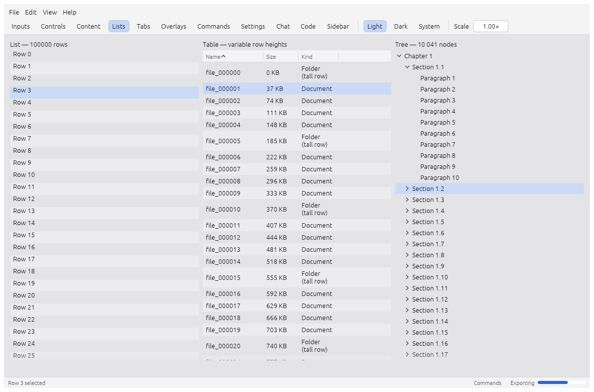
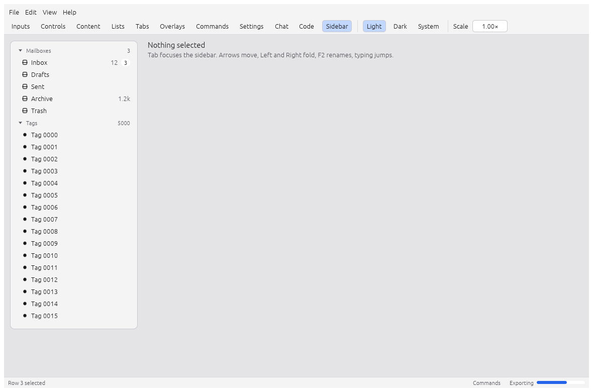
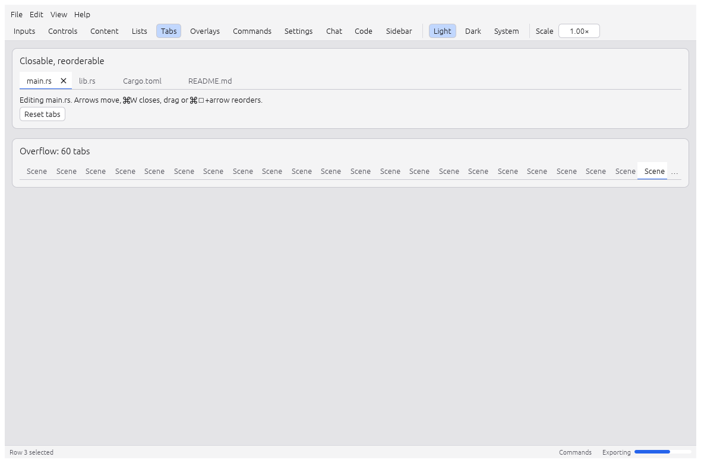
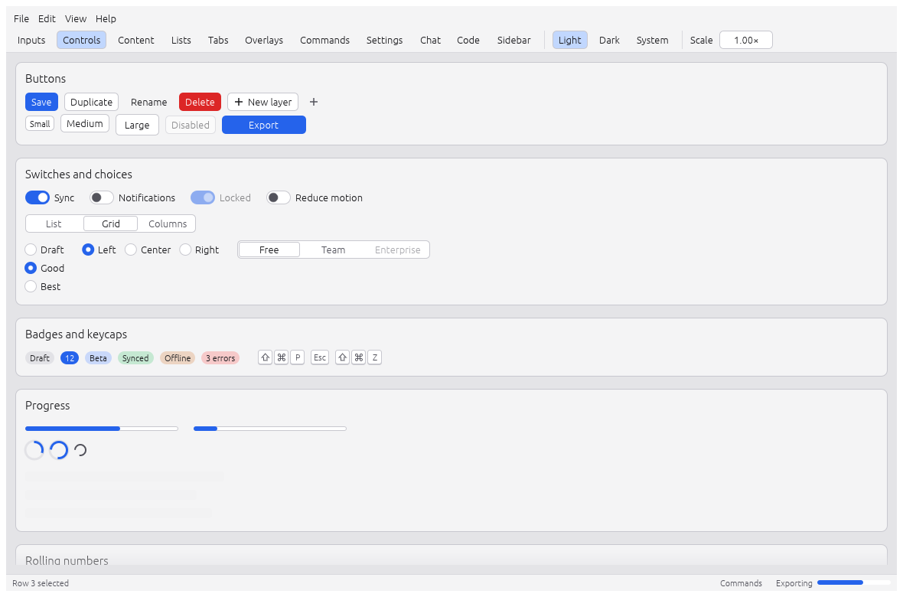
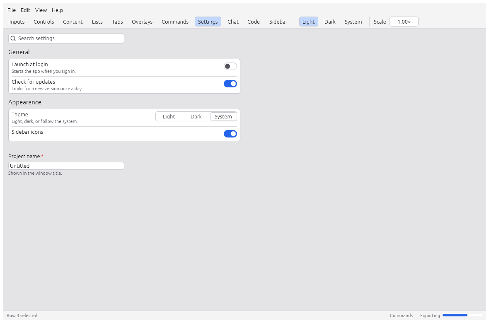
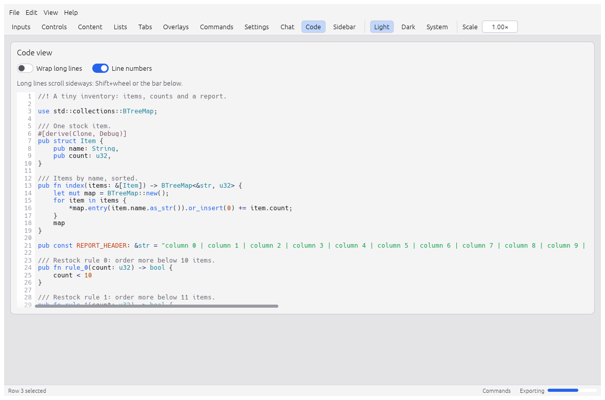
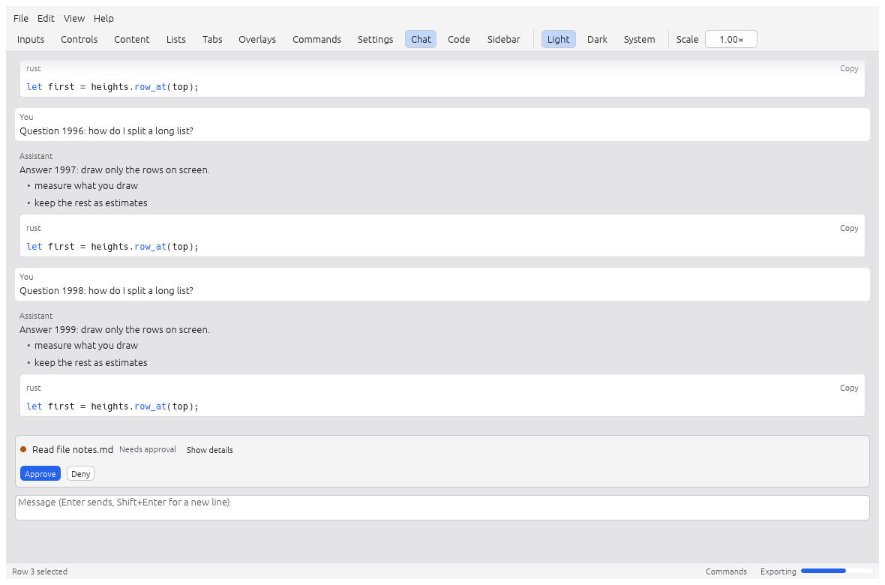

# Views and components

## The view and `Cx`

The view is a closure `FnMut(&mut egui::Ui, &mut Cx<'_, D>)` that draws the whole window each
frame. State the view keeps between frames lives in the closure:

```rust,ignore
fn view() -> impl FnMut(&mut egui::Ui, &mut Cx<'_, Notes>) {
    let mut query = String::new();
    move |ui, cx| {
        ui.text_edit_singleline(&mut query);
        for n in cx.doc().notes.iter().filter(|n| n.title.contains(&query)) {
            ui.label(&n.title);
        }
    }
}
```

What `Cx` offers:

| Call | What it does |
| --- | --- |
| `cx.doc()`, `cx.snapshot()`, `cx.revision()` | The document, as `&D` or `Arc<D>`, and its revision |
| `cx.dispatch(id, params)` | Run a command after the view returns |
| `cx.execute(id, params)` | Run a command now and get its result |
| `cx.edit(label, f)`, `cx.edit_merged(label, key, f)` | Edit the document directly, as an undo step |
| `cx.view(key)`, `cx.view_or(key, default)`, `cx.set_view(key, &value)` | View state |
| `cx.tokens()` | The theme's design tokens (`cx.tokens().space.md`) |
| `cx.motion(id, target, curve)` | An animated value that jumps for the user's own edits and animates for undo, agents and jobs |
| `cx.origin()` | Who changed the document since the last frame |
| `cx.dropped_files()` | Files dropped on the window that the runtime did not open |
| `cx.jobs`, `cx.toasts`, `cx.settings` | Background jobs, toasts, app settings |
| `cx.session()`, `cx.session_mut()`, `cx.ctx()` | The session and the egui context |

Frames are drawn only when something asks for one. Cache derived data by `cx.revision()` instead
of recomputing it each frame: the revision changes only when the document does.

## Components

The components are in `ashlar::ui` (the `ashlar-ui` crate). They take state by reference and
report what the user did; the app owns its data and selection. Every component registers an
automation id, so tests and agents can find it, and reports AccessKit roles to screen readers.

### Lists and tables

`list::Row` is a cheap row for short lists. For long ones, `virtual_list::VirtualList` lays out
only the visible rows, so a frame costs the same at 100 rows or 100,000:

```rust,ignore
use ashlar::ui::virtual_list::{RowHeights, VirtualList};

let out = VirtualList::new("files", names.len(), RowHeights::Uniform(22.0))
    .selected(*selected)
    .show(ui, |ui, row| {
        ui.label(&names[row.index]);
    });
if let Some(i) = out.select {
    *selected = Some(i);
}
```

`VirtualTable` does the same with columns and sorting, `selection::Selection` adds
multi-selection with a cursor and an anchor, and `tree::TreeView` shows a hierarchy.



### Sidebar

```rust,ignore
use ashlar::ui::sidebar::{Sidebar, SidebarItem, SidebarSection};

let items: Vec<SidebarItem> = names.iter().map(|n| SidebarItem::new(n)).collect();
let sections = [SidebarSection::new("Projects", &items)];
let out = Sidebar::new("nav", "Navigation", &mut state, &sections).show(ui);
if let Some((at, name)) = out.renamed {
    names[at.item] = name;
}
```

Sections fold and show counts; rows have an icon, a label, a detail and a badge, and support
type-ahead and rename in place.



### Tabs

```rust,ignore
use ashlar::ui::tabs::TabStrip;

let out = TabStrip::new("documents", &titles, &mut selected).closable(true).reorderable(true).show(ui);
if let Some(i) = out.closed { titles.remove(i); }
if let Some((from, to)) = out.moved { let t = titles.remove(from); titles.insert(to, t); }
```

Tabs that do not fit go to an overflow menu. For panels that users rearrange, see
[Panel docking](../docs/ui/ui-docking.md).



### Controls

`controls` has text buttons, a switch, a segmented control, radio groups, badges, keycaps,
progress bars and spinners; `buttons::IconButton`, `slider::Slider`, `slider::Knob`,
`value_field::ValueField` (a numeric drag field), `swatches::SwatchGrid` and `search::SearchField`
cover the rest.

```rust,ignore
use ashlar::ui::controls::{Button, Switch, Variant};

if Button::new("export.run", "Export").variant(Variant::Primary).loading(busy).show(ui).clicked() {
    cx.dispatch("doc.export", json!({}));
}
Switch::new("settings.sync", "Sync", &mut sync).show(ui);
```

Value edits (fields, sliders, knobs) report `edit::EditPhase` `Begin`, `Update`, `Commit` and
`Cancel`, which map onto `edit_merged` for one undo step per drag.



### Forms

The settings-form pattern: sections of rows with a label, a description and a control, a
"modified" marker with a reset button, and a filter.

```rust,ignore
use ashlar::ui::{controls::Switch, form};

form::filter(ui, "settings", &query, |f| {
    f.section("general", "General", |s| {
        s.row("launch", "Launch at login")
            .description("Starts with your session")
            .keywords(&["startup", "boot"])
            .bind(&mut launch, false)
            .control(|ui, id, on| Switch::new(id, "", on).show(ui));
    });
});
```



### Overlays and dialogs

`overlay::Select`, `overlay::Combobox` and `overlay::Popover` float next to a control;
`ashlar::ui::help(response, text)` adds a tooltip that screen readers also read.
`dialog::Dialog` is a modal with keyboard defaults:

```rust,ignore
use ashlar::ui::dialog::{Dialog, DialogButton, DialogOutcome};

let buttons = [DialogButton::cancel("Cancel"), DialogButton::destructive("Delete").default()];
match Dialog::new("confirm-delete", "Delete 3 files?", &buttons).show(ui.ctx(), |ui| {
    ui.label("This cannot be undone.");
}) {
    Some(DialogOutcome::Button(1)) => { /* delete */ }
    Some(_) => { /* closed */ }
    None => {}
}
```

### Toasts and the status bar

```rust,ignore
use ashlar::ui::toasts::Toast;

cx.toasts.push(Toast::success("Exported 12 files").action("Undo", "app.undo"));
```

From a command, use `s.toast(ToastLevel::Info, "…")`. With `App::run_toast_actions(true)`, a
clicked action whose command is registered runs like a menu pick.

`status_bar::StatusBar` is a strip along the bottom with left and right sections; `content` has
`EmptyState`, `Banner`, `Card`, `Collapsible` and `Accordion`.

### Markdown, code and diffs

```rust,ignore
use ashlar::ui::{code_view::CodeView, markdown};

let style = markdown::MarkdownStyle::from_visuals(ui.visuals(), 14.0);
markdown::show(ui, "help", text, &style);

CodeView::new("preview", source).lang_for_path("src/main.rs").revision(rev).show(ui);
```

The markdown view handles headings, lists, task lists, tables, code blocks with a Copy button and
links, and is safe to call on text that is still streaming in. `CodeView` is virtualized, with
line numbers, selection and syntax colours for 18 languages. `diff_view::DiffView` shows unified
or split diffs of `ashlar_diff::FileDiff`s with word-level emphasis.



### Chat

`chat` has a transcript, message and tool-call views, and a composer with an `@` / `/` popup.
They draw plain data and know nothing about where messages come from.

```rust,ignore
use ashlar::ui::chat::{Composer, Message, Transcript};

Transcript::new("chat", &messages, revision).stick_to_bottom(true).show(ui, |ui, m| {
    let id = format!("chat.msg.{}", m.id);
    Message::new(&id, m.role, &m.text).streaming(m.streaming).show(ui);
});
if let Some(text) = Composer::new("chat.input", &mut draft).placeholder("Ask anything").show(ui).submitted {
    // send `text`
}
```



### Motion

`ashlar::ui::motion` animates values with springs that keep their velocity when the target
changes, and asks for frames only while something moves:

```rust,ignore
use ashlar::ui::motion;

let alpha = motion::opacity(ui.ctx(), id, visible);
let width = motion::f32(ui.ctx(), id.with("w"), if open { 240.0 } else { 0.0 }, ashlar_motion::tokens::SNAP.enter);
```

Curves come from the `ashlar-motion` crate (`tokens::SNAP`, `SETTLE`, `GLIDE`, `POP` and others).
Motion follows the OS reduced-motion setting; `App::motion(prefs)` overrides it.

### Theme

`tokens` holds the design tokens (OKLCH colours, spacing, radii, type sizes, motion) for light,
dark and system modes; `cx.tokens()` returns the current ones. `fonts` installs app fonts with a
CJK fallback chain. The accent follows the OS accent colour unless
`App::follow_system_accent(false)` is set.

The gallery example shows every component:

```sh
cargo run -p ashlar-example-gallery
```

The full list is on [docs.rs/ashlar-ui](https://docs.rs/ashlar-ui).
