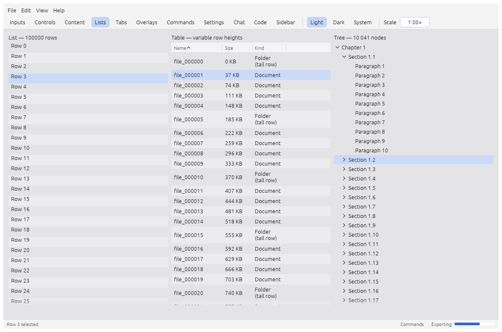

# Introduction

ashlar is a Rust library for building desktop apps (and, for its headless core, web apps) on
[egui](https://github.com/emilk/egui). It gives an app the parts most apps rebuild by hand:

- **Documents with undo**: the document is an `Arc` snapshot with a revision number, every edit is
  an undo step, and the file format is versioned with migrations. Autosave and crash recovery come
  with it.
- **Commands**: one registry drives the menus, keyboard shortcuts, the command palette, a CLI, a
  control port and an MCP server. Anything a user can do, a script or an AI agent can do too.
- **Background jobs** with progress, cancellation and panic isolation, whose results land on the UI
  thread as one undo step.
- **Files and settings**: per-app folders, atomic writes, keyed settings, recent files.
- **Native OS features**: file dialogs, the menu bar, a tray icon, global shortcuts,
  notifications, drag and drop, single instance.
- **UI components** on egui: lists and tables that stay fast at any length, a sidebar, tabs, forms,
  dialogs and popovers, toasts, markdown, code and diff views, a chat kit, animated values.
- **A runtime** with crash safety, telemetry, and a headless mode for tests and agents.

Domain widgets (a timeline for a video editor, a canvas for a CAD tool) stay in the app. ashlar
provides the general pieces they are built from.

*The component gallery (`cargo run -p ashlar-example-gallery`), rendered headless.*

## Why

- **Everything is a command.** Menus, shortcuts, the palette, the CLI, the control port and MCP all
  go through one registry and one execute chokepoint.
- **It does not crash.** The library has no `unwrap`, `panic!` or `unsafe` outside tests. A panic
  in a view, a command or a job is caught, the session keeps running, and unsaved work is
  recovered on the next launch.
- **An idle app does no work.** Frames are drawn only when something asks for one: input, a
  document change, a finished job, a running animation.
- **Apps can be tested and driven without a window.** Every app takes
  `--headless --snap out.png --tree tree.json`, runs `.ui` scripts on a virtual clock, and serves
  golden screenshots and named scenes.

## Status

| | |
|---|---|
| Version | 0.2. The API will change between minor versions until 1.0. |
| License | [BSD 3-Clause](https://github.com/Himasnhu-AT/ashlar/blob/main/LICENSE) |
| Rust | 1.95 or newer (edition 2024) |
| egui / eframe | 0.36, wgpu renderer |
| Platforms | macOS (Apple silicon and Intel), Windows 10+ x86_64, Linux x86_64 (X11 and Wayland), web (`wasm32-unknown-unknown`, experimental for the windowed runtime) |

The full API reference is on [docs.rs/ashlar-rs](https://docs.rs/ashlar-rs). The source is on
[GitHub](https://github.com/Himasnhu-AT/ashlar).

## Where to start

1. [Install](guide/installation.md) the crate.
2. Build [your first app](guide/first-app.md).
3. Read the `notes` example in the repository
   ([examples/notes](https://github.com/Himasnhu-AT/ashlar/tree/main/examples/notes)): a complete
   app with typed commands, undo, autosave, a virtualized list, scenes and a `notes-cli` binary.
